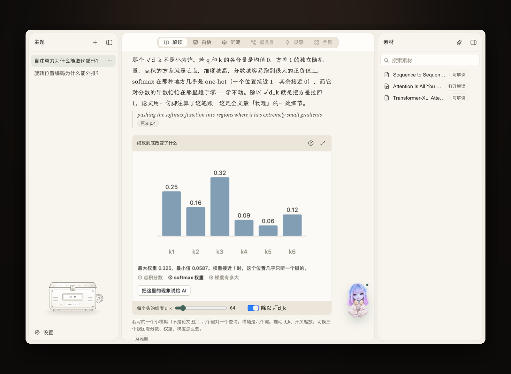

<div align="center">



# Lumen

学习万物的本机工作台：围绕一个好奇的问题开主题，和 AI 一起把想清楚的东西画在白板上。

</div>

Lumen 使用 Mastra 管理 Agent、工具循环、问答、审批、后台专家和持久对话。主题、资料库、白板、研究工具与桌面交互由 Lumen 提供。

- 主题：一个好奇的问题一个主题；状态灯显示 AI 在运行还是在等你。一个主题同一时刻只跑一段对话。
- 白板：一张张有容量（8 块）的白板，AI 用专用工具画文字、理解梯子、表格和实时小部件；每块带出处，没有出处就标「AI 推断」。白板对人只读，每次运行结束存一个版本。
- 对话精灵：对话退到右下角，可拖动、停靠、收起；换对话不换白板，新对话从白板现状接着说。
- 资料库：原件只存一份，主题按引用使用；右栏「素材」按加入时间列出，AI 找来的会标明，点开在白板旁分屏阅读。
- 研究工具：论文/引用/网页检索、PDF/DOCX 读取（可收进资料库作出处）、支持视觉的模型直接理解图片。
- 多 Agent：内建角色和分层 Markdown 自定义角色；专家产物写入独立目录，主研究者整合；专家只能看白板，不能画。
- 代码执行：Node/Python 隔离执行、明确审批、超时和停止；网络通过受限代理。
- 本地诊断：原生 trace、问题标注、脱敏导出，以及隔离录制回放/当前模型无工具评估。文本匹配不代表研究质量。

## 开发

需要 Node.js 24 或以上。

```sh
npm install
npm run dev
```

打开 `http://localhost:5180`，在设置中填写模型接口、模型名和 API Key。支持 OpenAI 兼容接口与 Anthropic 协议。开发数据默认在 `~/.lumen-studio-dev`；可通过 `LUMEN_MASTRA_HOME` 显式指定独立根。

```sh
npm run typecheck
npm test
npm run verify
```

## macOS 桌面

桌面应用 `Lumen Studio.app`（bundle id `com.lumen.studio`）默认连接 `~/.lumen-studio` 中发现的 `com.lumen.studio` 服务；不连旧形态的 `~/.lumen-mastra` / `com.lumen.mastra`，两者可以并存。

```sh
npm run launchd:install -w @lumen/mastra-service -- \
  --node /绝对路径/node \
  --project-root /绝对路径/lumen \
  --data-root /绝对路径/.lumen-studio
npm run tauri:build -w packages/ui-client
```

安装产物位置以构建日志为准（`…/bundle/macos/Lumen Studio.app`）。当前桌面仍需要本机 Node 和项目目录；不是包含运行时与公证签名的独立安装包。

新根的模型档案可用 `start.ts --settings <旧根>/settings.json` 一次性导入（只允许导入到未初始化的根，旧根只读）。预览部署使用独立 label（`com.lumen.studio.preview`）和数据根，不与正式服务共享数据库。详见 `packages/mastra-service/scripts/CLAUDE.md`。

## 架构

```text
packages/mastra-service/   Mastra + Hono，消息/运行由框架持有
packages/ui-client/        React + 官方 HTTP/SSE SDK + Tauri 薄壳
```

当前职责、边界与取舍见 [Mastra 架构](doc/mastra/architecture.md)；产品模型与规则见 `doc/studio/`。旧自研循环、WS 协议和重复消息存储已退出运行路径。

## License

[MIT](LICENSE)
