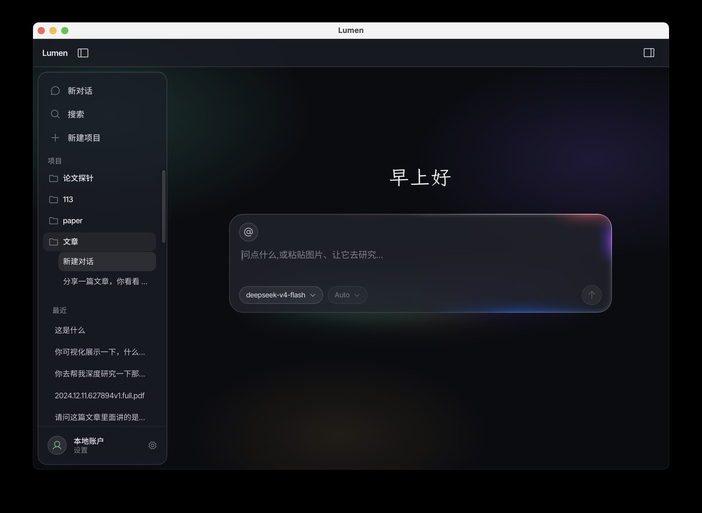

<div align="center">



# Lumen

本机论文研究工作台：读材料、核对证据、协作分析，把结果留在真实文件中。

</div>

Lumen 使用 Mastra 管理 Agent、工具循环、问答、审批、后台专家和持久对话。项目、材料、研究工具与桌面交互由 Lumen 提供。

- 项目与会话：标题搜索、置顶、归档、未读和重开历史。
- 研究工作区：任务文件、共享资料、只读外部目录、跨会话项目记忆。
- 研究工具：论文/引用/网页检索、PDF/DOCX 读取、支持视觉的模型直接理解图片。
- 多 Agent：六类内建角色和分层 Markdown 自定义角色；专家产物写入独立目录，主研究者整合。
- 代码执行：Node/Python 隔离执行、明确审批、超时和停止；网络通过受限代理。
- 桌面阅读：PDF 页码、Markdown、图片、HTML 和 widget 沙箱；文件经原生保存对话框导出。
- 本地诊断：原生 trace、问题标注、脱敏导出、旧证据只读浏览，以及隔离录制回放/当前模型无工具评估。文本匹配不代表研究质量，trace 不等于完整网络/文件副作用审计。

## 开发

需要 Node.js 24 或以上。

```sh
npm install
npm run dev
```

打开 `http://localhost:5180`，在设置中填写模型接口、模型名和 API Key。支持 OpenAI 兼容接口与 Anthropic 协议。开发数据默认在 `~/.lumen-mastra-dev`；可通过 `LUMEN_MASTRA_HOME` 显式指定独立根。

```sh
npm run typecheck
npm test
npm run verify
```

## macOS 桌面

桌面默认连接 `~/.lumen-mastra` 中发现的 `com.lumen.mastra` 服务。

```sh
npm run launchd:install -w @lumen/mastra-service -- \
  --node /绝对路径/node \
  --project-root /绝对路径/lumen \
  --data-root /绝对路径/.lumen-mastra
npm run tauri:build -w packages/ui-client
```

安装产物位置以构建日志为准。当前桌面仍需要本机 Node 和项目目录；不是包含运行时与公证签名的独立安装包。

旧数据只能使用显式离线导入命令迁往空目录；旧根保持不变。详见 `packages/mastra-service/scripts/CLAUDE.md`。预览部署使用独立 label 和数据根，不与正式服务共享数据库。

## 架构

```text
packages/mastra-service/   Mastra + Hono，消息/运行由框架持有
packages/ui-client/        React + 官方 HTTP/SSE SDK + Tauri 薄壳
```

当前职责、边界与取舍见 [Mastra 架构](doc/mastra/architecture.md)。旧自研循环、WS 协议和重复消息存储已退出运行路径。

## License

[MIT](LICENSE)
